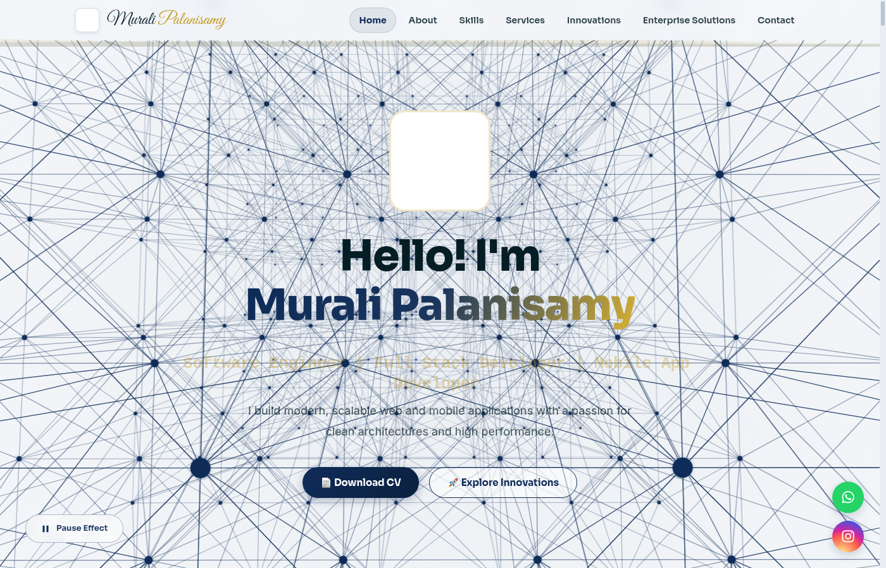
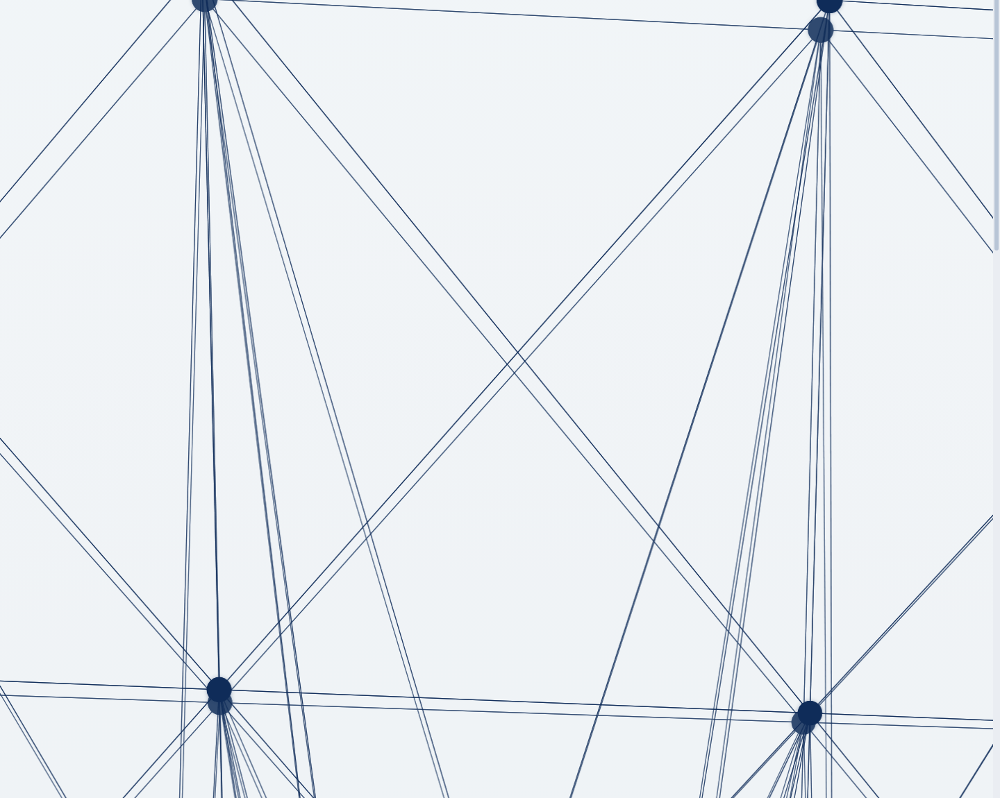
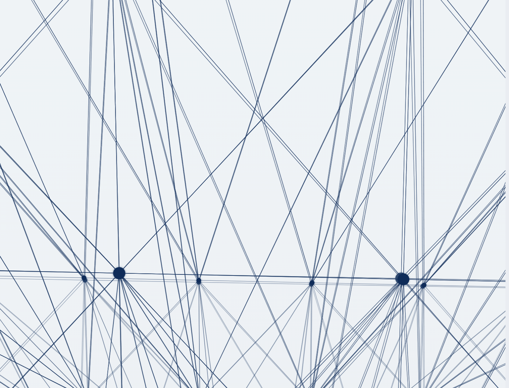
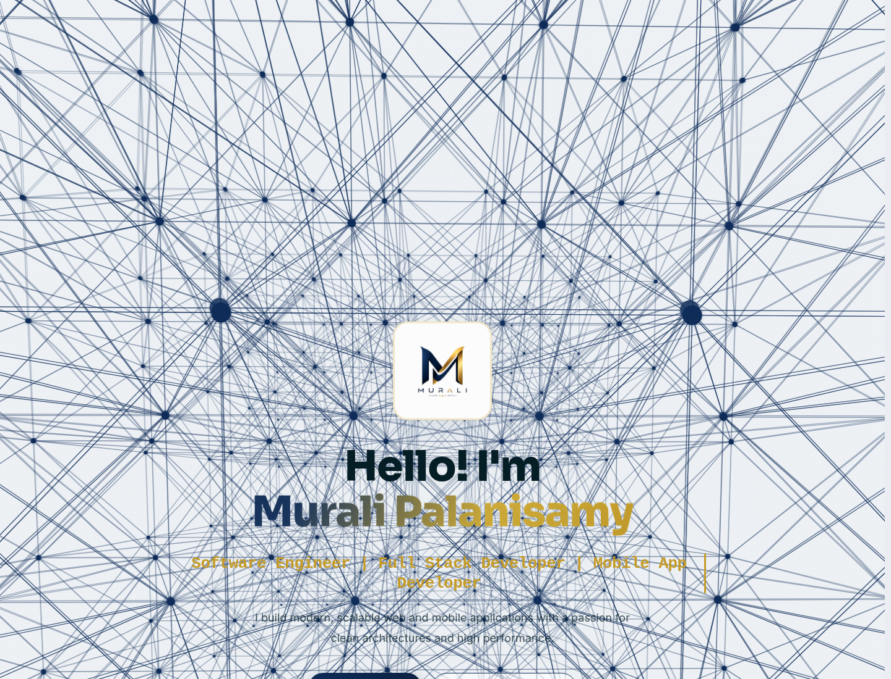
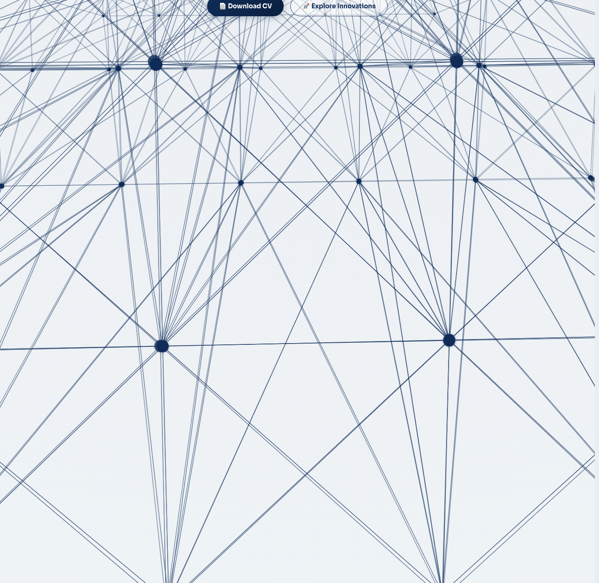
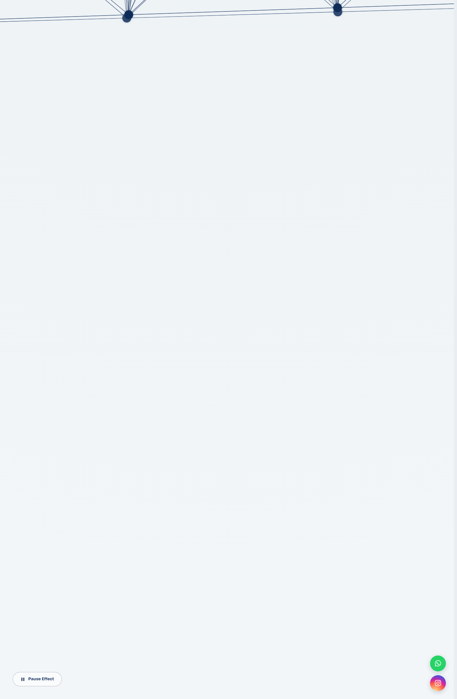

# 🚀 Murali Palanisamy — Software Engineer Portfolio

> A modern, ultra-responsive, high-performance personal portfolio website built with **React 19**, **Vite**, and **Material UI (MUI)**. Featuring an interactive 3D particle neural network canvas, dynamic theme aesthetics, smooth single-page scrolling, and a showcase of independent innovations and enterprise solutions.

---

## 📸 Visual Showcase & Screenshots

<div align="center">

### 🌟 Hero & Interactive 3D Canvas


*Interactive 3D particle neural mesh with real-time physics, touch & click impulse wave animations, and typography.*

<br/>

### 👨‍💻 About Me & Certified Accreditations


*Professional summary, verified skill highlights, interests, and verified Udemy Python accreditation.*

<br/>

### 🛠️ Technical Skills & Core Proficiencies


*Modern 3D interactive skill cards with dynamic hover glow effects across Python, PHP, React, Next.js, and Odoo.*

<br/>

### 💼 Comprehensive Professional Services


*Full-stack engineering offerings ranging from Web & Mobile Apps to ERP Automation, DB Management, and UI/UX Design.*

<br/>

### 🚀 Independent Innovations & Products


*Production applications including Resume Builder, Mavora Bookvexa 3D PDF Reader, HomeWallet, and Nuvexa Developer Utilities.*

<br/>

### 🏢 Enterprise Solutions & Direct Contact


*Corporate systems (Events, DWM, Kontact Odoo ERP, Central Kitchen POS, Canine Office) and an interactive direct contact terminal.*

</div>

---

## ✨ Key Features

- **⚡ Performance & Zero Lag**: Integrated `IntersectionObserver` with hardware-accelerated animations ensuring 60fps buttery-smooth scroll performance.
- **🌐 Seamless Single-Page Experience**: Instant smooth-scrolling anchors with an active **ScrollSpy** navbar header and wave-flow animations.
- **🎨 Interactive 3D Neural Canvas**: 3D mathematical lattice mesh with rotational easing, interactive touch rotation, and pulse impulses on click.
- **📱 Fully Responsive & Glassmorphic UI**: Tailored layouts for Mobile, Tablet, and Desktop screens built with custom Material UI light theme styling.
- **🔍 Image Lightbox Viewer**: Built-in modal image zoom preview for certificates, logos, and architecture screenshots.
- **📬 Direct Contact Integration**: One-click direct email dispatcher supporting both Google Gmail Web and Mailto protocols.

---

## 🛠️ Technology Stack

| Category | Technologies |
|---|---|
| **Frontend Core** | React 19, JavaScript (ESNext), HTML5 Canvas API |
| **Styling & UI** | Material UI (MUI v9), Emotion, CSS Keyframe Animations |
| **Bundler & Build Tool** | Vite 8, Rolldown (Optimized Vendor Code-Splitting) |
| **Icons & Typography** | MUI Icons, Google Fonts (*Sora*, *Inter*, *Fira Code*, *Great Vibes*) |
| **Deployment** | Vercel / Nginx / Static Web Hosting |

---

## 📂 Project Architecture

```text
my_website/
├── public/
│   ├── images/               # Logos, certificates, SVG backgrounds, and assets
│   └── static/files/         # Downloadable CV and documents
├── src/
│   ├── components/           # Reusable UI components
│   │   ├── Footer.jsx        # Footer with multi-layer SVG waves and navigation
│   │   ├── Navbar.jsx        # Fixed header with active ScrollSpy & animated wave ribbon
│   │   ├── NeuralCanvas.jsx  # Interactive 3D particle background canvas
│   │   └── UIComponents.jsx  # Skill cards, Project cards, and Animated counters
│   ├── context/
│   │   └── LightboxContext.jsx # Global image lightbox preview provider
│   ├── data/
│   │   └── portfolioData.jsx   # Data source for skills, services, projects & clients
│   ├── pages/                # Section components
│   │   ├── HomePage.jsx      # Hero landing section with metrics
│   │   ├── AboutPage.jsx     # Professional biography & certificates
│   │   ├── SkillsPage.jsx    # Technical competencies grid
│   │   ├── ServicesPage.jsx  # Solutions & service offerings
│   │   ├── PersonalProjectsPage.jsx # Independent Innovations showcase
│   │   ├── ProjectsPage.jsx  # Enterprise Solutions & client marquee
│   │   └── ContactPage.jsx   # Contact channels & messaging form
│   ├── theme/
│   │   └── theme.js          # Unified theme palette & color token utilities
│   ├── App.jsx               # Main single-page application layout
│   ├── index.css             # Keyframe animations and global utility styles
│   └── main.jsx              # React DOM entry point
├── package.json              # Project dependencies and build scripts
└── vite.config.js            # Build configuration with custom vendor chunking
```

---

## 💻 Getting Started Locally

### Prerequisites
- Node.js (v18.0 or newer)
- npm or yarn

### Installation

1. **Clone the repository:**
   ```bash
   git clone https://github.com/muralivijay2001/my_website.git
   cd my_website
   ```

2. **Install dependencies:**
   ```bash
   npm install
   ```

3. **Start the local development server:**
   ```bash
   npm run dev
   ```
   Open [http://localhost:5173](http://localhost:5173) in your browser to view the application.

4. **Create a production build:**
   ```bash
   npm run build
   ```

5. **Preview production build locally:**
   ```bash
   npm run preview
   ```

---

## 👨‍💻 Author

**Murali Palanisamy**  
*Software Engineer | Full Stack Developer | Mobile App Developer*

- 📧 **Email:** [muralip.software.engineer@gmail.com](mailto:muralip.software.engineer@gmail.com)
- 📍 **Location:** Chennai, India
- 💼 **Portfolio:** [Live Website](https://muralisoftware.vercel.app/)
- 🌐 **Live Demo:** [https://muralisoftware.vercel.app/](https://muralisoftware.vercel.app/)

---

## 📄 License
This project is open source and available under the [MIT License](LICENSE).

